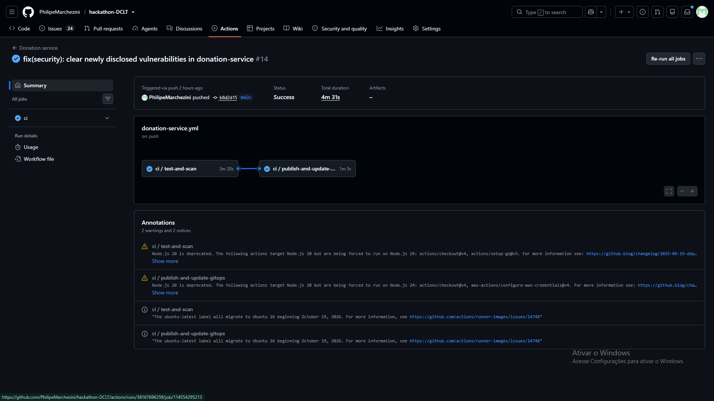
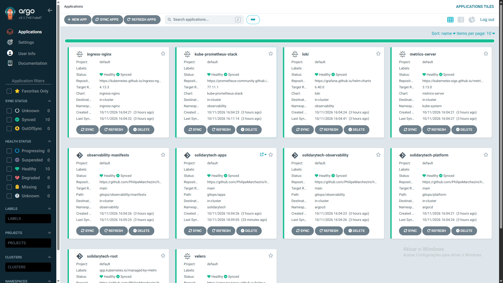
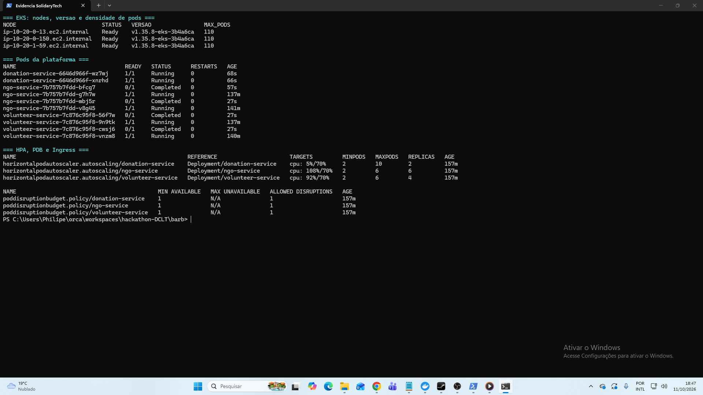
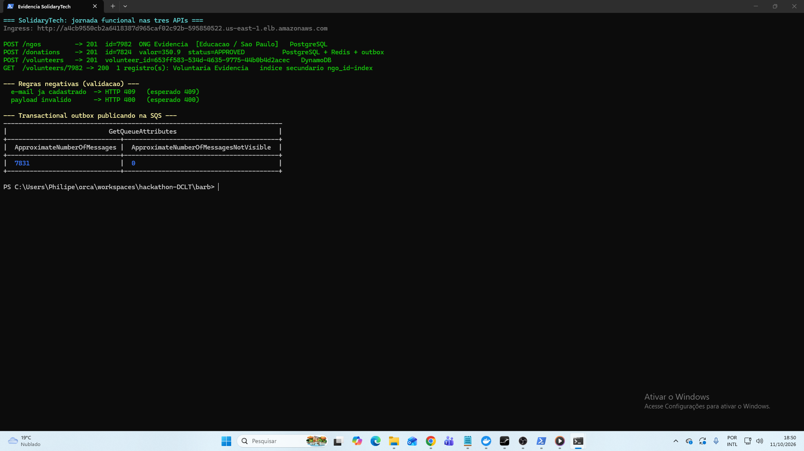
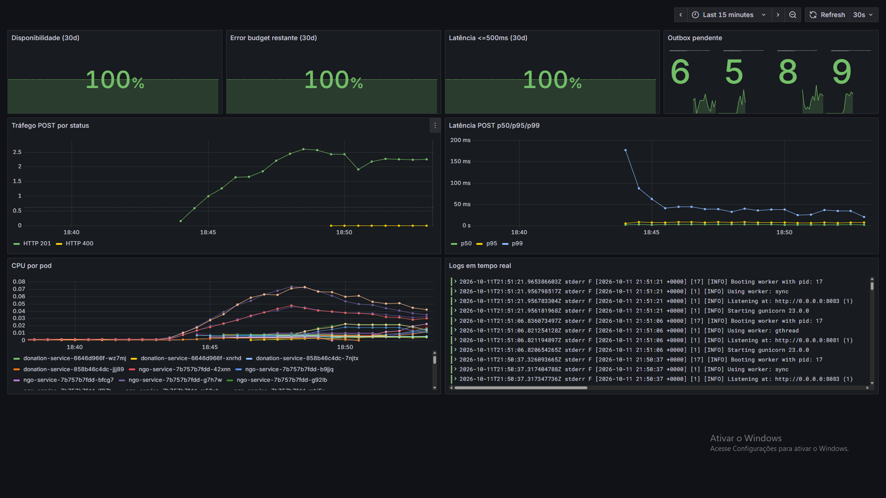
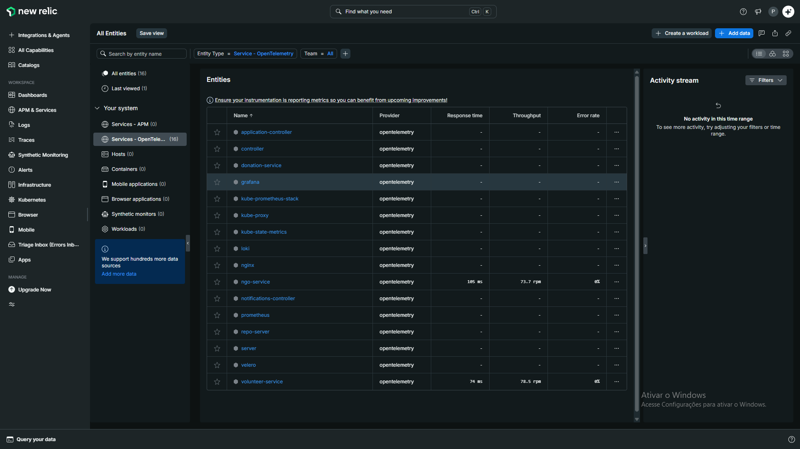
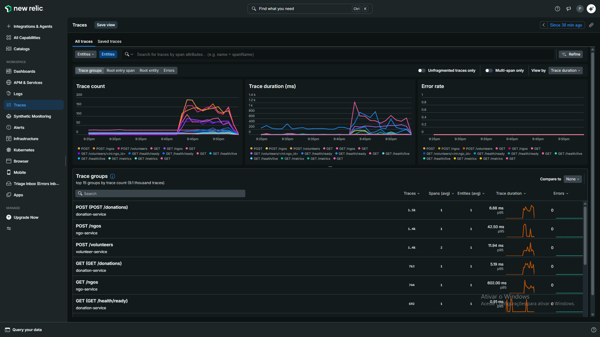
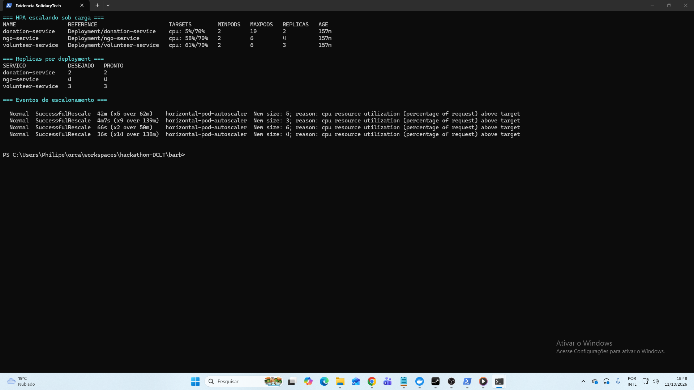
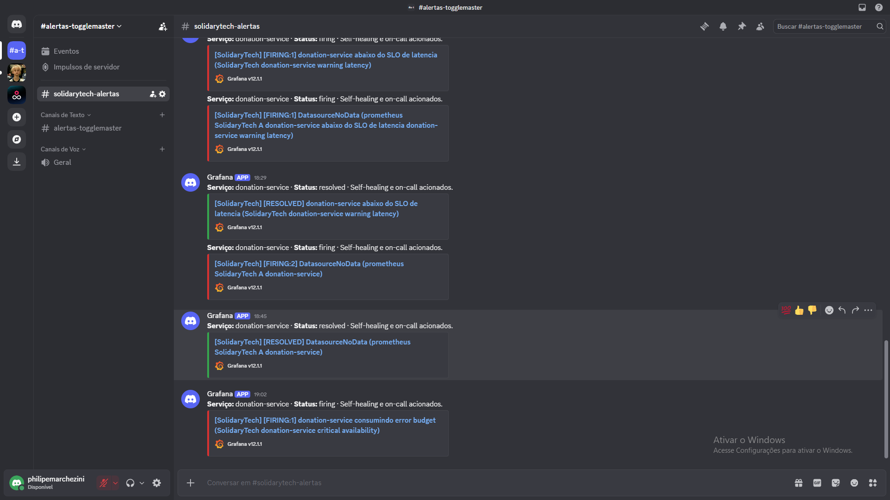
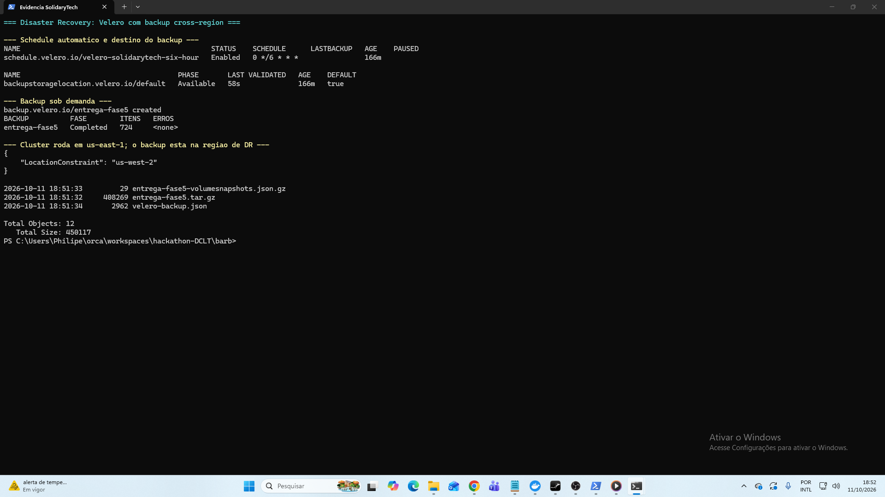

# POSTECH — Hackathon DCLT — Fase 5

## SolidaryTech: plataforma resiliente, observável e orientada a SRE

**Aluno:** Philipe de Oliveira Marchezini

**RM:** 369453

**Username:** `philipemarchezini`

**Repositório de entrega:** `https://github.com/PhilipeMarchezini/hackathon-DCLT`

**Vídeo:** https://youtu.be/Vxywcx1LQpY

**Data:** outubro de 2026

## 1. Resumo executivo

Esta entrega consolida a evolução da SolidaryTech realizada nas fases anteriores e transforma os três microsserviços fornecidos em uma plataforma operável. A solução contempla desenvolvimento local, infraestrutura AWS como código, Kubernetes com GitOps, CI/CD, observabilidade de métricas/logs/traces, práticas SRE, FinOps, ITSM/AIOps e um Plano de Continuidade de Negócio.

O `donation-service` foi definido como jornada crítica. Ele recebeu cache Redis, escalabilidade horizontal, PodDisruptionBudget, SQS com DLQ e transactional outbox para eliminar a janela em que a doação seria persistida sem que o evento fosse publicado. O objetivo interno é 99,9% de disponibilidade e 99% das respostas em até 500 ms; o SLA proposto é 99,5%.

A implantação foi desenhada para as limitações do AWS Academy: reaproveita `LabRole`, mantém custos reduzidos e evita NAT Gateway. As concessões são registradas para não confundir um laboratório funcional com o desenho recomendado de produção.

A ferramenta de APM escolhida é o New Relic Free. A decisão entre Datadog e New Relic é exclusiva e pesou o custo zero da conta educacional e a disponibilidade do Applied Intelligence no plano gratuito, que atende ao requisito de AIOps. A stack de métricas e logs é Prometheus, Grafana e Loki, e o OpenTelemetry Collector roteia traces e métricas para o New Relic via OTLP.

## 2. Evolução e rastreabilidade

As fases 1–4 forneceram a progressão de aplicação, containers/cloud, Kubernetes/automação e observabilidade. A fase 5 integra esses resultados em uma operação fim a fim. A matriz detalhada está em `docs/RASTREABILIDADE.md`.

Os três domínios permanecem isolados:

- NGO: Flask + PostgreSQL, responsável pelo cadastro e consulta das organizações.
- Donation: Go + PostgreSQL + Redis + SQS, responsável pela jornada crítica de doação.
- Volunteer: Flask + DynamoDB, responsável por voluntários e consulta por ONG via GSI.

Todos possuem endpoints live/ready, métricas Prometheus, logs JSON estruturados com `trace_id`, instrumentação OpenTelemetry, testes e imagens multi-stage executadas sem root.

## 3. Arquitetura e segurança

A infraestrutura Terraform cria VPC em duas zonas, EKS 1.35 com dois nodes `t3.medium`, três repositórios ECR imutáveis com replicação cross-region, dois RDS PostgreSQL, ElastiCache Redis, Global Table DynamoDB com PITR, SQS/DLQ e armazenamento de backup Velero na região DR. Os backups automatizados dos dois RDS são replicados para a região DR com KMS.

O tráfego entra pelo NGINX Ingress. RDS e Redis permanecem em sub-redes privadas e seus Security Groups aceitam somente a origem do cluster. Containers usam `runAsNonRoot`, seccomp, capabilities removidas e filesystem read-only. NetworkPolicies aplicam deny-by-default para ingress e liberam somente o Ingress e a observabilidade. Secrets são materializados por script diretamente na API do Kubernetes e não são versionados.

No laboratório, os nodes estão em sub-redes públicas para evitar o custo do NAT; em uma implantação real eles devem migrar para sub-redes privadas e usar VPC Endpoints/saída controlada. A ampla `LabRole` também deve ser substituída por Pod Identity/IRSA e políticas de privilégio mínimo.

## 4. CI/CD e GitOps

Cada serviço possui workflow independente e reutiliza um pipeline central. Pull requests executam testes unitários, lint (ruff/gofmt/go vet), SAST (bandit no Python, gosec no Go), SCA (pip-audit no Python, govulncheck no Go) e scan Trivy da imagem com bloqueio em severidade CRITICAL. No branch principal, a imagem é publicada no ECR com tag `sha-xxxxxxx`; o workflow atualiza somente a imagem daquele deployment. O Argo CD detecta o commit e sincroniza o cluster.

As migrações SQL são Jobs PreSync idempotentes. A plataforma instala NGINX Ingress, Metrics Server, Velero e a stack de observabilidade antes das aplicações. Sync waves reduzem condições de corrida com CRDs. Os três serviços têm HPA por CPU com alvo de 70%: Donation escala de 2 a 10 réplicas e NGO e Volunteer de 2 a 6, enquanto o PDB conserva ao menos uma disponível em cada um. O script `scripts/gerar-carga.ps1` gera a carga que evidencia o escalonamento.

Um workflow agendado audita pods anormais, solicita refresh do Argo CD e abre GitHub Issue. Ele complementa os mecanismos nativos; não executa correções destrutivas nem substitui investigação humana.

### 4.1 O portão de segurança em operação

O bloqueio por vulnerabilidade não é decorativo, e há duas ocorrências reais registradas no histórico do repositório.

Na primeira, a introdução do `govulncheck` reprovou o `donation-service` com **30 vulnerabilidades alcançáveis** em seis módulos e na biblioteca padrão do Go. A correção exigiu elevar a linguagem de 1.25.7 para 1.27.1, migrar `jackc/pgx` de v4 para v5 — a série v4 está em fim de vida e suas falhas não tinham correção publicada — e atualizar OpenTelemetry, gRPC, `x/net` e `x/text`.

Na segunda, durante a reconstrução do ambiente para a gravação, o mesmo portão reprovou o serviço por **vulnerabilidades divulgadas naquele mesmo dia**: `GO-2026-6617` em `golang.org/x/net`, corrigida na v0.60.0, e onze achados alcançáveis na biblioteca padrão, corrigidos no go1.27.2. Nenhuma linha de código havia mudado desde o build anterior.

A distinção importa: o `govulncheck` faz análise de alcançabilidade e reporta apenas vulnerabilidades em funções que o código efetivamente chama, o que elimina o ruído típico das ferramentas de composição e torna o bloqueio defensável.

## 5. SRE e observabilidade

### 5.1 SLIs, SLO e SLA

| Indicador | Objetivo |
|---|---:|
| Disponibilidade técnica de Donation | 99,9% não-5xx em 30 dias |
| Latência de Donation | 99% ≤ 500 ms em 30 dias |
| SLA externo proposto | 99,5% mensal |
| Error budget interno | 0,1%, aproximadamente 43m49s/mês |

Prometheus calcula taxa de requisições, erro, p95 e backlog do outbox. Grafana reúne tráfego, disponibilidade, error budget, latência, CPU e logs. Os alertas cobrem erro acima de 1%, p95 acima de 500 ms, outbox represado e queima acelerada do budget.

Logs JSON seguem para Loki. Traces e telemetria OTLP podem ser encaminhados ao New Relic Free com uma license key fornecida fora do Git; o procedimento concreto de baseline, correlação e workflow está em `docs/NEW-RELIC-AIOPS.md`. PagerDuty Free, Discord e GitHub podem receber incidentes; sem essas chaves, a observabilidade interna continua operacional.

### 5.2 Resiliência aplicada

O outbox grava doação e evento na mesma transação. Publicadores concorrentes usam `FOR UPDATE SKIP LOCKED`; uma falha de SQS mantém o item pendente e incrementa tentativas. Isso oferece entrega ao menos uma vez, portanto consumidores devem deduplicar pelo identificador da doação. Redis é best-effort: sua falha não bloqueia leitura do PostgreSQL.

Probes separam vida de prontidão. Kubernetes reinicia containers e remove pods não prontos do tráfego; HPA reage a carga; PDB reduz indisponibilidade voluntária; Argo CD corrige drift.

## 6. ITSM e AIOps

Alertas são classificados em P1/P2/P3 com tempos de reconhecimento e cadência de comunicação. Um P1 de Donation deve ser reconhecido em até 10 minutos, ter mitigação alvo em até 60 minutos e gerar post-mortem em até dois dias úteis.

O ciclo adotado é: detectar → enriquecer → registrar incidente → triar/correlacionar → mitigar → validar SLI → post-mortem. MTTD e MTTR são derivados dos timestamps de sintoma, alerta e restauração. O GitHub Issue fornece trilha auditável; PagerDuty/Discord aceleram mobilização quando configurados.

## 7. PCN e Disaster Recovery

A estratégia é pilot light, apropriada ao orçamento: Git/Terraform reconstrói o plano de controle, Velero copia estado Kubernetes a cada seis horas para o bucket S3 da região DR, a Global Table DynamoDB mantém PITR e os backups automatizados dos dois RDS são replicados para a região DR. O state separado de failover reaproveita esses recursos, sem tentar recriá-los.

- **RTO:** 4 horas.
- **RPO de dados relacionais:** 24 horas.
- **RPO de objetos Kubernetes:** 6 horas.

O runbook em `docs/PCN-DR.md` define declaração de desastre, restauração PITR em state separado, reaproveitamento da Global Table/bucket/ECR, recriação de secrets, smoke test, decisão de DNS e failback. Testes trimestrais de Velero, semestrais de RDS e anual de região devem medir os objetivos em vez de apenas assumir que o backup funciona.

## 8. FinOps

Tags de projeto, ambiente, centro de custo e Terraform permitem showback. ECR aplica lifecycle; DynamoDB/SQS são on-demand; recursos de compute possuem requests/limits e sizing pequeno. A estimativa educacional para o laboratório ligado 24×7 é aproximadamente USD 225/mês, sujeita à calculadora vigente, tráfego e impostos.

A principal economia do laboratório é não usar NAT Gateway. Isso é adequado à demonstração, mas a produção real exigiria segurança e alta disponibilidade maiores: RDS Multi-AZ, Redis com failover, nodes privados e persistência durável da observabilidade. O teardown após a banca evita consumo desnecessário.

### 8.1 Rightsizing: densidade de pods por node

O caso mais concreto de otimização surgiu durante o provisionamento. Os nodes saturaram e nenhuma aplicação era mais agendada, com o escalonador reportando `Too many pods`. A leitura das métricas, porém, mostrava **CPU em 41% e memória em 33%** — havia capacidade ociosa e, ainda assim, não havia espaço.

O gargalo não era de computação e sim de rede. O VPC CNI atribui a cada pod um endereço IP real da VPC, e o número de endereços disponíveis decorre da quantidade de interfaces que o tipo de instância suporta. Um `t3.medium` para em **17 pods**, independentemente de CPU e memória.

A reação intuitiva seria adicionar instâncias, ou seja, pagar por capacidade que já estava ociosa. A correção adequada foi habilitar a delegação de prefixo no VPC CNI, que faz a interface receber blocos de dezesseis endereços em vez de um por vez, e declarar `maxPods` explicitamente no `NodeConfig` do launch template — passo necessário porque o EKS calcula o limite no bootstrap do node e não refaz a conta ao ligar a delegação.

O mesmo `t3.medium` passou a comportar **110 pods**: seis vezes e meia a densidade, sem instância adicional e sem aumento de custo. O ganho também viabilizou a demonstração de HPA, que antes não tinha onde alocar réplicas novas.

## 9. Execução e evidências

O projeto pode ser validado localmente com `docker compose up --build -d`. O README descreve o bootstrap Terraform, a configuração do `kubectl`, o preenchimento seguro de secrets e a primeira publicação de imagens.

A plataforma foi provisionada e validada na conta AWS Academy `713071293995`, com o cluster `solidarytech-production-eks` em operação e carga gerada por `scripts/gerar-carga.ps1`. As capturas abaixo vêm desse ambiente real; nenhuma é simulada. O conjunto completo, com quinze imagens, está em `docs/evidencias/`.

### 9.1 Fundação: CI/CD, GitOps e Kubernetes

### 9.2 Jornada funcional e transactional outbox

### 9.3 SRE e observabilidade

### 9.4 Resposta a incidentes, de ponta a ponta

A Fase 4 pede a prova real: provocar uma falha e demonstrar a resposta. Um gatilho `BEFORE INSERT` na tabela `donations` passou a lançar exceção. A escolha isola o caminho crítico — a readiness probe executa `SELECT 1` e continuou passando, os pods permaneceram no balanceamento, as leituras seguiram em 200 e os outros serviços não foram afetados. Apenas o `POST /donations` passou a retornar 500, que é exatamente o SLI de disponibilidade protegido pelo SLO.

A taxa de erro subiu de 0% para 53% em cinco minutos, a regra entrou em disparo após a janela de dois minutos, a notificação alcançou o ponto de contato e o canal de ChatOps, o webhook acionou a automação de recuperação e o serviço foi reiniciado. A remoção do gatilho devolveu a taxa de erro a zero e resolveu o alerta.

### 9.5 FinOps e continuidade

### 9.6 O portão de segurança reprovando um build

### 9.7 Limitação declarada

O restore cronometrado do Velero não foi executado. O backup está comprovado em 9.5, mas a medição do tempo de recuperação ficou pendente, e o relatório não a apresenta como feita. O `README.md` de `docs/evidencias/` registra essa lacuna.

## 10. Conclusão

A entrega transforma o código inicial em uma base completa de engenharia de plataforma. Os mecanismos escolhidos conectam confiabilidade, custo e operação: CI reduz defeitos antes do deploy; GitOps torna mudanças auditáveis; telemetria mede a experiência crítica; error budget orienta prioridade; outbox e backup reduzem perda de dados; ITSM organiza resposta; FinOps torna as concessões explícitas.

Como próximos passos de produção ficam domínio/TLS, WAF, Pod Identity/IRSA, bancos Multi-AZ, Redis com réplica, persistência longa de Prometheus/Loki e exercício documentado do failover regional.

## Referências internas

- `README.md`
- `docs/ARQUITETURA.md`
- `docs/SRE.md`
- `docs/FINOPS.md`
- `docs/PCN-DR.md`
- `docs/ITSM-AIOPS.md`
- `docs/NEW-RELIC-AIOPS.md`
- `docs/RASTREABILIDADE.md`
